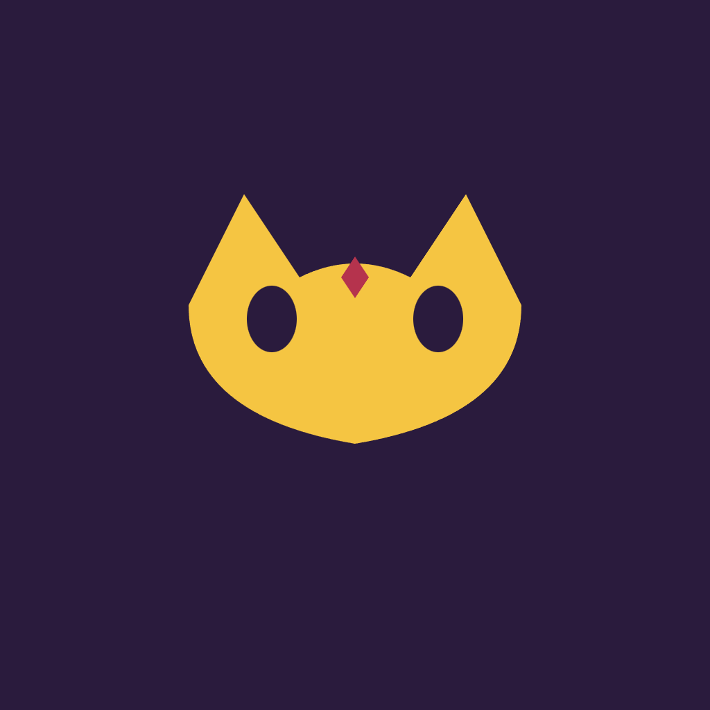

# Masquera



Collect, animate, and battle with NFT werewolf characters in a Web3 social deduction game.

## Overview

Masquera turns the classic werewolf (mafia) social deduction game into a character-collection experience. Players own animated NFT avatars with unique traits that unlock special in-game abilities, such as a Seer's reveal or a Witch's potion. An in-house anime designer creates distinct character art and animations, while the smart contract layer handles trait-based ability triggers and cosmetic marketplace trading.

## Problem

Most Web3 games either ignore art and identity entirely, or treat NFTs as static speculative assets with no real gameplay utility. Collectors end up holding JPEGs with no reason to keep playing or caring about them.

## Solution

Masquera gives each NFT character functional, trait-driven special abilities inside live werewolf matches. Characters are designed by an anime artist to maximize emotional attachment and long-term tradability, turning collecting into a gameplay decision rather than a speculative bet.

## Features (MVP)

- Mint animated NFT werewolf characters with randomized trait-based special roles/abilities
- On-chain ability resolution: trait metadata determines in-game power (e.g. double-vote, immunity)
- Marketplace for trading/renting character NFTs between matches
- Free starter characters for new players alongside premium animated collections
- Leaderboard NFT badges minted for top-performing characters each season

## Tech Stack

- Solana, Anchor, Rust (on-chain programs)
- Metaplex Token Metadata (NFT traits and metadata)
- React, Solana Wallet Adapter (frontend)
- Figma/Procreate pipeline for animation export
- IPFS/Arweave for decentralized asset storage

## How It Works

```
Player Wallet
    |
    v
Mint NFT (Metaplex) --> Trait Metadata (IPFS/Arweave)
    |
    v
Join Match (React client)
    |
    v
Anchor Program reads traits --> resolves ability on-chain
    |
    v
Match outcome --> Leaderboard NFT badge minted
    |
    v
Marketplace: trade / rent characters between matches
```

Players mint or acquire an animated NFT character. When they join a match, the on-chain program reads the character's trait metadata to assign a role and power. Abilities such as reveals, immunity, or double-votes are resolved on-chain during gameplay. After matches, top performers can earn leaderboard badge NFTs, and all characters remain tradable or rentable on the marketplace.

## Roadmap

- Partner with artists for themed NFT character drops
- Add character leveling/evolution mechanics based on win history
- Launch cross-game character portability via an open metadata standard

## Pitch

- [Pitch deck (PDF)](docs/pitch.pdf)
- [Pitch script](docs/pitch-script.md)

## Team

- Name / Role — placeholder
- Name / Role — placeholder
- Name / Role — placeholder

Built for the Colosseum hackathon (Solana and other chains).

---

🎬 Pitch video: [docs/pitch-video.mp4](docs/pitch-video.mp4)
